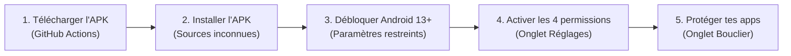

# 🛡️ Cosmos Shield — Traqueur d'Habitudes, Bouclier & Sommeil (Android)

<div align="center">


**Traqueur d'habitudes, bouclier anti-distraction & sanctuarisation du sommeil pour Android.**

[](https://android.com)
[](https://kotlinlang.org)
[](https://tailwindcss.com)
[](https://github.com)
[](LICENSE)

</div>

---

## 🌟 Qu'est-ce que Cosmos Shield ?

**Cosmos Shield** est une application tout-en-un alliant **Traqueur d'Habitudes (Habit Tracking)**, **Bouclier Anti-Dopamine** et **Protection du Sommeil**.

Elle s'articule autour de 3 piliers essentiels pour reprendre sa vie en main :
1. 🎯 **Bâtir des routines positives** : suivi d'habitudes quotidiennes avec grilles de cohérence annuelles.
2. 🛡️ **Éliminer les distractions toxiques** : interception des applications chronophages et sas de respiration consciente.
3. 🌙 **Protéger son sommeil** : couvre-feu digital et blocus strict des écrans la nuit.

Contrairement aux applications classiques :
- 🔒 **100% autonome et hors ligne** : aucun compte, aucun abonnement, zéro télémétrie, aucune requête réseau.
- ⚡ **Ultra légère et native** : tourne en continu avec une consommation batterie quasi nulle.
- 🧠 **Psychologie comportementale active** : valorise la régularité et remplace les mauvaises impulsions par de la pleine conscience.

---

## ✨ Fonctionnalités Clés

### 🎯 1. Suivi d'Habitudes & Grilles de Cohérence (Habit Tracker)
- **Check-in quotidien fluide** : valide tes habitudes de la journée en un tapotement (sport, lecture, sommeil 8h, méditation, apprentissage...).
- **Presets intégrés & habitudes sur-mesure** : active en un clic les meilleures routines prouvées ou crée tes propres habitudes personnalisées.
- **Grilles annuelles de pixels (Heatmaps style GitHub)** : visualise ta constance sur l'année entière avec une grille dynamique de 365 jours. Ne brise pas la chaîne !
- **Suivi des séries (Streaks) & Taux de réussite** : calcul automatique des séries en cours, records personnels et pourcentages de complétion mensuels/annuels.
- **Traqueurs de Détox & Sobriété** : chronomètres d'abstinence en temps réel pour vaincre les addictions (écrans, pornographie, malbouffe, stimulants...) avec gestion des rechutes.
- **Bilan du Matin interactif** : rituel de réveil pour évaluer la qualité de son sommeil (curseur d'heures) et valider la veille (*journée 100% Clean*).

### 🫁 2. Breath Gate (Sas d'Interception Conscient)
Dès qu'une application ciblée (Instagram, TikTok, YouTube, X, Reddit...) est ouverte :
- Cosmos Shield passe instantanément au premier plan.
- **6 secondes de respiration guidée** (inspiration / expiration) pour casser le réflexe automatique de dopamine.
- Choix délibéré d'une micro-session chronométrée (1 à 5 minutes) avant ré-interception.

### 🌙 3. Sommeil, Couvre-feu & Blocus Nocturne
- **Plage horaire entièrement personnalisable** (par défaut **22h00 → 08h00**, ou raccourcis rapides *23h-7h*, *21h30-7h30*).
- **Blocus strict des applications la nuit** : pendant le couvre-feu, les applications surveillées sont totalement verrouillées afin d'empêcher les sessions nocturnes.
- **Filtre noir & blanc nocturne automatique** : élimine les couleurs vives et l'attrait visuel dès que commence le couvre-feu.
- **Rappels programmés sur mesure** :
  - 🌙 Notification de couvre-feu du soir pour poser le téléphone et prendre un livre.
  - ☀️ Notification du bilan matinal pour évaluer sa nuit et valider ses victoires.

### 🌫️ 4. Filtre Gris (Grayscale Overlay) Sans ADB
- Atténue la stimulation cérébrale en affichant un filtre désaturant transparent au-dessus des applications chronophages.
- **Aucune commande ADB ni droit root requis** : fonctionne directement via la permission native de superposition Android.
- Intensité réglable en temps réel de 10% à 100%.

### 📊 5. Suivi du Temps d'Écran Réel Android
- Mesure directe et automatique via l'API système Android (`UsageStatsManager`).
- Jauges de temps d'écran par rapport à tes objectifs quotidiens de détox.

### 🎨 6. Thèmes & Design Sombre OLED
- 4 palettes de couleurs soignées (*Cosmique*, *White Calm*, *Warrior*, *Blue & Black*).
- Bascule instantanée entre mode Sombre profond (OLED) et mode Clair épuré.

---

## 📲 Guide d'Installation Rapide (depuis le GitHub APK Builder)

Tu n'as besoin d'aucun environnement de développement sur ton ordinateur pour installer et utiliser l'application.



### Étape 1 : Télécharger l'APK compilé
1. Rends-toi sur l'onglet [**Actions**](../../actions) de ce dépôt GitHub.
2. Clique sur le dernier workflow réussi intitulé **Build APK**.
3. En bas de la page, dans la section **Artifacts**, clique sur **`CosmosShield-apk`**.
4. Décompresse l'archive `.zip` téléchargée pour obtenir le fichier `app-release.apk`.

### Étape 2 : Installer l'APK sur ton téléphone
1. Envoie le fichier `app-release.apk` sur ton smartphone (via câble USB, Google Drive, WhatsApp ou téléchargement direct depuis le navigateur du téléphone).
2. Ouvre le fichier APK pour lancer l'installation.
3. Si Android affiche une alerte de sécurité, sélectionne **« Paramètres »** puis active **« Autoriser cette source »**.
4. Valide l'installation puis ouvre **Cosmos Shield**.

### Étape 3 : Débloquer les paramètres restreints (Indispensable sur Android 13, 14 et 15+)
Sur les versions récentes d'Android, Google bloque par mesure de sécurité l'accès aux permissions avancées pour toutes les applications installées hors du Play Store. **Il faut déverrouiller ce verrouillage une seule fois :**

1. Reste appuyé sur l'icône de l'application **Cosmos Shield** sur ton écran d'accueil.
2. Appuie sur **Infos sur l'application** (ou icône ℹ️).
3. Appuie sur les **3 petits points verticaux (⋮)** situés tout en haut à droite de l'écran.
4. Sélectionne **« Autoriser les paramètres restreints »** (Allow restricted settings).
5. Confirme avec ton empreinte digitale, ton code PIN ou ton schéma.

> [!TIP]
> Si l'option des 3 points ⋮ n'apparaît pas immédiatement, ouvre d'abord Cosmos Shield, va dans **Réglages**, clique sur une permission qui est refusée, puis retourne dans les Infos de l'application.

### Étape 4 : Activer les permissions requises
Dans l'application Cosmos Shield, ouvre l'onglet **Réglages** (icône ⚙️) et active les accès système :

| Permission | Rôle | Pourquoi elle est requise ? |
| :--- | :--- | :--- |
| **1. Données d'utilisation** | Mesure d'activité | Permet de lire le temps d'écran réel et de détecter l'ouverture d'une application protégée. |
| **2. Affichage par-dessus** | Superposition d'écran | Permet d'ouvrir le sas de respiration et le filtre gris devant l'application interceptée. |
| **3. Notifications** | Alertes système | Permet d'envoyer le rappel de couvre-feu (soir) et le bilan matinal (réveil). |
| **4. Batterie sans restriction** | Persistance arrière-plan | Empêche le constructeur (Xiaomi, Samsung, Pixel...) d'endormir le bouclier. |

### Étape 5 : Choisir les applications à surveiller
1. Rends-toi sur l'onglet **Bouclier** (icône 🛡️).
2. Appuie sur **« Choisir une application installée »**.
3. Coche tes applications chronophages (réseaux sociaux, jeux, navigateurs...).
4. C'est prêt ! Dès que tu tenteras d'ouvrir une de ces applications, le sas de respiration prendra le relais.

---

## 🛠️ Compilation Manuelle (Développeurs)

### Avec Android Studio
1. Télécharge et ouvre le projet dans Android Studio.
2. Laisse Gradle synchroniser les dépendances (Java 17 requis).
3. Connecte ton téléphone en débogage USB et clique sur **Run ▶** (ou génère l'APK via `Build > Build APK(s)`).

### En ligne de commande
```bash
# Compiler l'APK Release optimisé
./gradlew assembleRelease

# L'APK est généré dans :
# app/build/outputs/apk/release/app-release.apk
```

---

## 💻 Personnalisation de l'Interface Web

L'interface de l'application est écrite en HTML moderne, JavaScript natif et TailwindCSS. Elle est embarquée localement dans les assets de l'application Android :

```bash
cd web
npm install
npm run build
```

La commande `npm run build` :
1. Compile et minifie les styles Tailwind CSS dans `app/src/main/assets/www/app.css`.
2. Synchronise les icônes Lucide, les polices Inter & JetBrains Mono et le fichier `index.html`.

---

## 📂 Architecture du Projet

```
CosmosShield/
├── .github/workflows/
│   └── build-apk.yml          # Pipeline CI/CD GitHub Actions (APK Builder)
├── app/src/main/
│   ├── assets/www/            # Interface compilée embarquée hors ligne
│   ├── java/com/cosmos/shield/
│   │   ├── MainActivity.kt    # WebView conteneur & injection de l'interface
│   │   ├── NativeBridge.kt    # Pont de communication JavaScript ↔ Android
│   │   ├── ShieldService.kt   # Service d'arrière-plan de détection et blocus
│   │   ├── Prefs.kt           # Gestionnaire persistant de préférences & sessions
│   │   ├── Reminders.kt       # Programmation des réveils et notifications
│   │   ├── Usage.kt           # Extraction du temps d'écran Android réel
│   │   └── GrayscaleOverlay.kt# Moteur de superposition d'écran désaturé
│   └── AndroidManifest.xml    # Configuration et permissions système Android
└── web/
    ├── index.html             # Source de l'application Web & interfaces graphiques
    ├── build.mjs              # Script de compilation Tailwind et copie d'assets
    └── package.json           # Dépendances de build frontend
```

---

## 🛡️ Respect de la Vie Privée

- **0 accès internet demandé** dans le manifeste Android (`android.permission.INTERNET` est absent).
- **Aucun compte requis**, toutes les données restent stockées sur ton appareil.
- **Code source 100% ouvert et vérifiable**.
